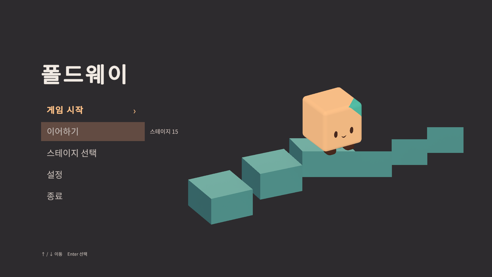
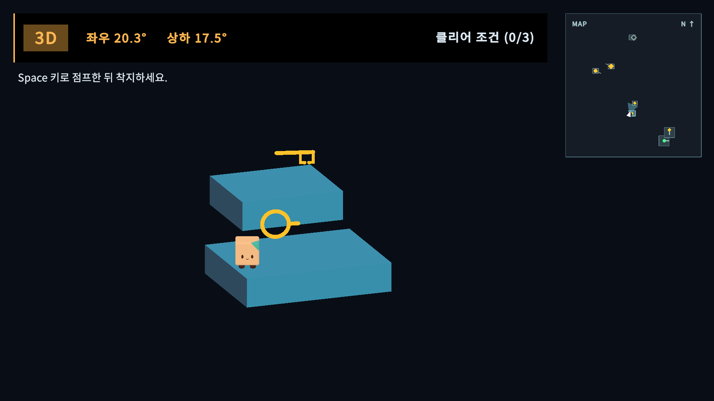
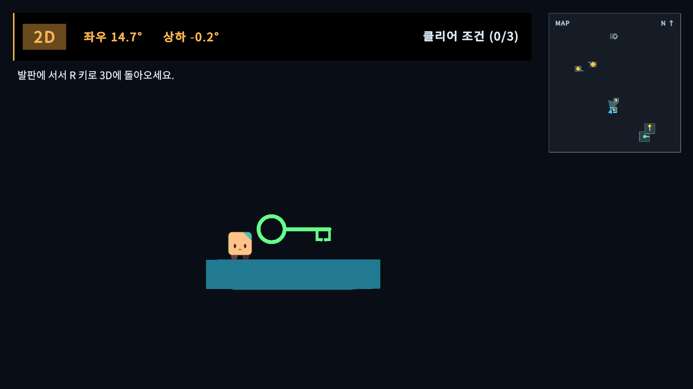
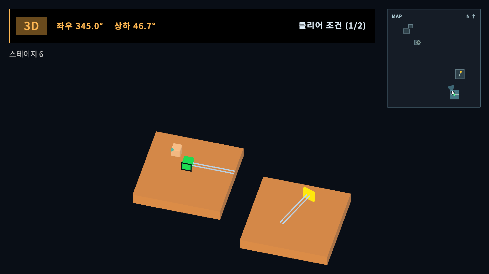
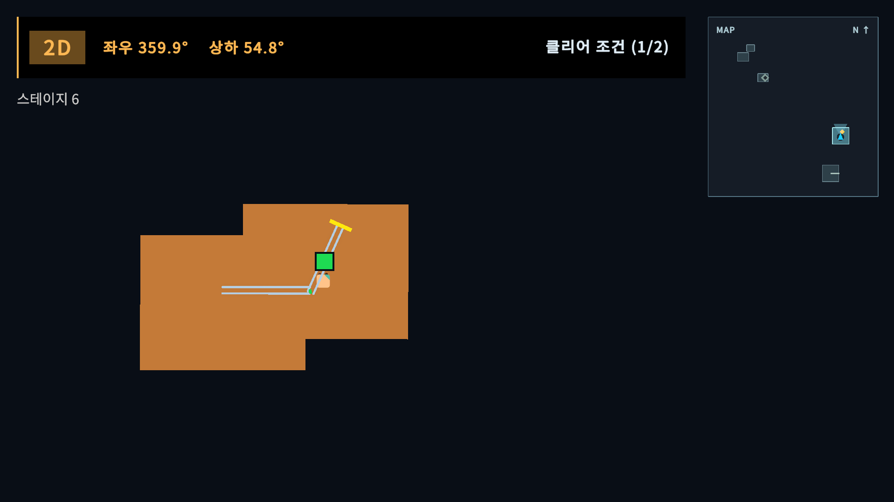
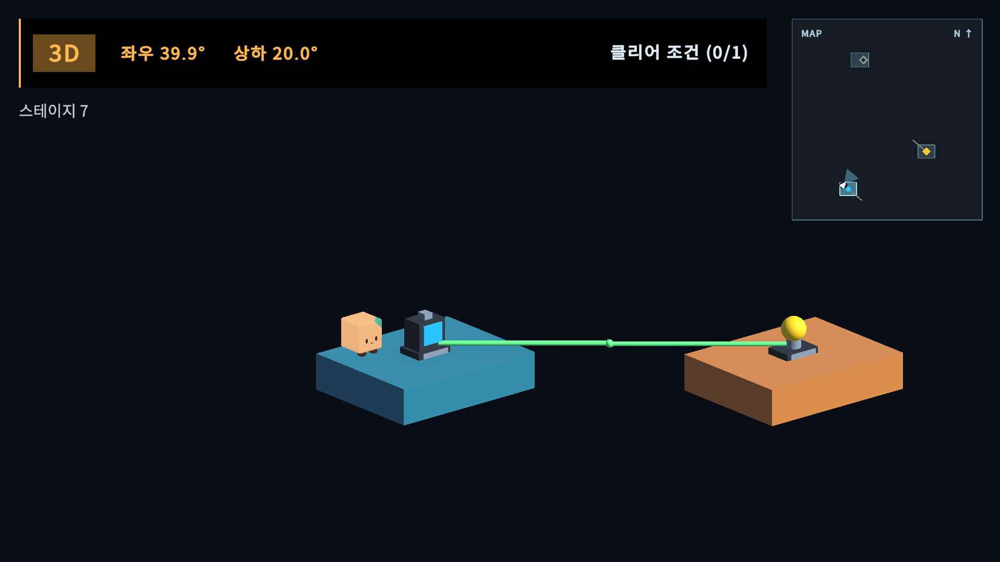
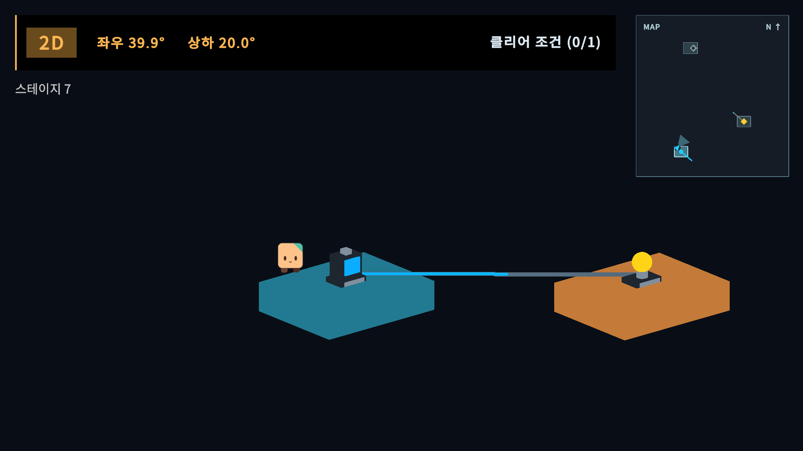
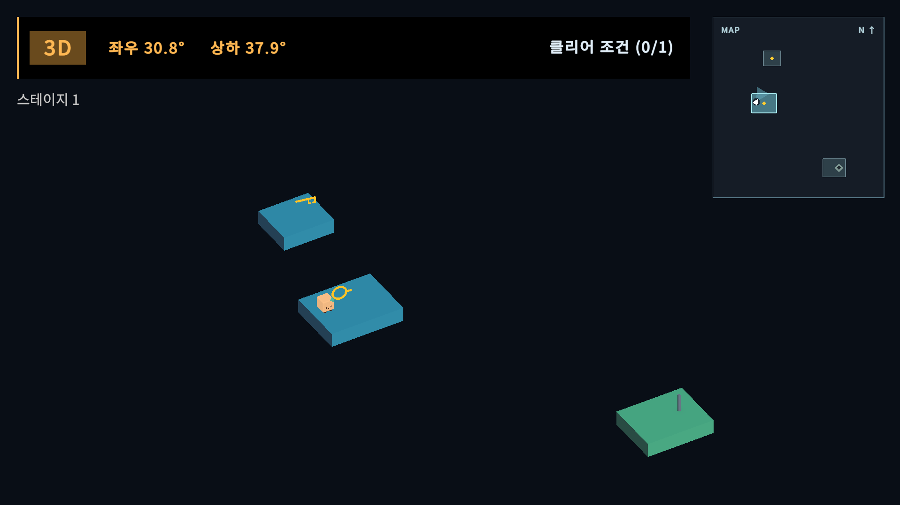
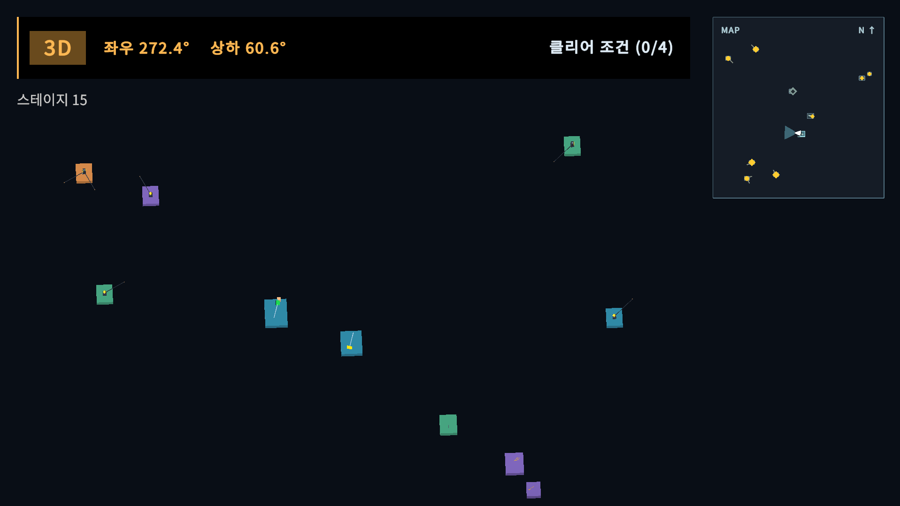

<div align="center">

# 폴드웨이 · Foldway

### 시점을 돌려 길을 잇고, 3D와 2D를 오가는 퍼즐 게임

<p>
  
  
  
</p>

3D에서 카메라를 돌려 떨어진 발판과 장치를 맞추고, 2D로 전환해 길을 건너세요.<br>
열쇠를 맞추고, 레일 스위치를 밀고, 전선을 이어 출구를 엽니다.

</div>

---

## 🎬 게임 플레이 영상

<div align="center">
  <a href="https://www.youtube.com/watch?v=EXByOno_9-4">
    
  </a>
  <br>
  <a href="https://www.youtube.com/watch?v=EXByOno_9-4">YouTube에서 게임 플레이 영상 보기</a>
</div>

---

## 📸 게임 화면

### 3D에서 2D로 전환 · 열쇠 퍼즐

튜토리얼에서는 3D 공간에 흩어진 열쇠 조각을 시점 회전으로 맞춥니다. `R`로 횡스크롤 2D에 들어가면, 화면에서 이어진 열쇠를 획득할 수 있습니다.

<table>
  <tr>
    <td width="50%" align="center"></td>
    <td width="50%" align="center"></td>
  </tr>
  <tr>
    <td align="center"><sub>3D · 떨어진 열쇠 조각</sub></td>
    <td align="center"><sub>횡스크롤 2D · 정렬된 열쇠</sub></td>
  </tr>
</table>

### 탑뷰 2D · 레일 퍼즐

06 스테이지에서는 위에서 내려다보는 각도로 두 레일을 맞춥니다. 탑뷰 2D로 전환한 뒤 `WASD`로 움직여 꺾인 레일을 따라 스위치를 목표까지 밉니다.

<table>
  <tr>
    <td width="50%" align="center"></td>
    <td width="50%" align="center"></td>
  </tr>
  <tr>
    <td align="center"><sub>3D · 분리된 레일 구간</sub></td>
    <td align="center"><sub>탑뷰 2D · 연결된 레일 위의 스위치</sub></td>
  </tr>
</table>

### 전력 퍼즐

07 스테이지에서는 전선이 연결될 각도를 찾으면 3D에서 전선이 초록색으로 표시됩니다. 2D로 전환하면 전력이 흐르기 시작하고, 충전된 구간은 파란색으로 표시됩니다.

<table>
  <tr>
    <td width="50%" align="center"></td>
    <td width="50%" align="center"></td>
  </tr>
  <tr>
    <td align="center"><sub>3D · 연결 가능한 각도</sub></td>
    <td align="center"><sub>2D · 충전 중인 회로</sub></td>
  </tr>
</table>

### 캠페인 전경

01 스테이지에서는 열쇠 하나를 맞춰 출구를 엽니다. 15 스테이지에서는 여러 높이에 흩어진 열쇠, 레일, 전력 장치를 서로 다른 시점에서 해결합니다.

<table>
  <tr>
    <td width="50%" align="center"></td>
    <td width="50%" align="center"></td>
  </tr>
  <tr>
    <td align="center"><sub>01 · 처음 맞는 조각</sub></td>
    <td align="center"><sub>15 · 마지막 전력망</sub></td>
  </tr>
</table>

---

## 🎮 게임 플레이 & 특징

- **시점 기반 지형 투영** — 3D 카메라의 방향과 기울기에 따라 2D 지형이 달라집니다. 떨어진 발판을 화면에서 이어 건넌 뒤 실제 3D 발판 위로 돌아옵니다.
- **두 가지 2D 이동 방식** — 낮은 각도에서는 횡스크롤로 좌우 이동과 점프를 하고, 가파른 각도에서는 탑뷰로 전환해 평면을 이동합니다.
- **열쇠·레일·전력 퍼즐** — 열쇠 조각을 맞춰 획득하고, 맞물린 레일을 따라 스위치를 밀고, 전선을 이어 전구나 다음 전원에 전력을 보냅니다.
- **튜토리얼과 15개 스테이지** — 튜토리얼에서 이동과 시점 전환, 세 가지 장치를 연습합니다. 메인 메뉴에서 스테이지를 선택하거나 마지막으로 입장한 스테이지의 시작 지점에서 이어할 수 있습니다.
- **미니맵과 진행도** — 미니맵에서 실제 3D 배치와 장치 위치를 확인하고, HUD에서 현재 모드와 각도, 남은 클리어 조건을 확인합니다.

### 기본 조작

| 조작 | 기능 |
| --- | --- |
| `R` | 3D ↔ 2D 전환 |
| `WASD` | 3D 또는 탑뷰 2D에서 이동 |
| `A` / `D` | 횡스크롤 2D에서 좌우 이동 |
| `Space` | 3D 또는 횡스크롤 2D에서 점프 |
| 마우스 우클릭 + 드래그 | 3D 카메라 회전 |
| 마우스 좌클릭 + 드래그 / 휠 | 카메라 화면 이동 / 확대·축소 |
| `Backspace` | 현재 스테이지 초기화 |
| `Esc` | 일시정지 |
| `5` / 숫자패드 `5` | 조작 안내 표시·숨김 |
| `Enter` | 출구 도착 후 다음 스테이지로 이동 |

---

## 🛠 Tech Stack

- **엔진·언어** — Unity 6000.0.68f1, C#
- **렌더링** — Universal Render Pipeline 17.0.4
- **입력·UI** — Unity Input System 1.18.0, uGUI, TextMeshPro

## 📂 주요 소스 코드 및 프로젝트 구조

```text
My project/Assets/_Game/
├─ Scenes/                      # 메인 메뉴와 캠페인 씬
├─ Prefabs/UI/                  # 공용 HUD 프리팹
├─ Scripts/
│  ├─ ProjectionPrototype.cs   # 차원 전환과 카메라 제어
│  ├─ ProjectionMath.cs        # 2D 투영과 3D 복귀에 쓰이는 좌표 계산
│  ├─ ProjectionMinimap.cs     # 실제 3D 배치를 보여주는 미니맵
│  ├─ Puzzles/                 # 열쇠, 레일, 전력 회로 로직
│  └─ Campaign/                # 튜토리얼과 스테이지 진행 처리
└─ Tests/                       # EditMode 및 PlayMode 테스트
```

## 🚀 다운로드 및 실행 (Windows 64비트)

1. [Foldway-Windows.zip](https://github.com/wkdrudgnsdla/PuzzleGame/releases/latest/download/Foldway-Windows.zip)을 다운로드합니다.
2. ZIP 파일을 우클릭하고 **모두 압축 풀기**를 선택합니다.
3. 압축을 푼 폴더에서 `Foldway.exe`를 실행하고 **게임 시작**을 선택합니다.

[캠페인 스테이지 안내](docs/CampaignStages.md) · [프로젝트 가이드](docs/ProjectGuide.md)
